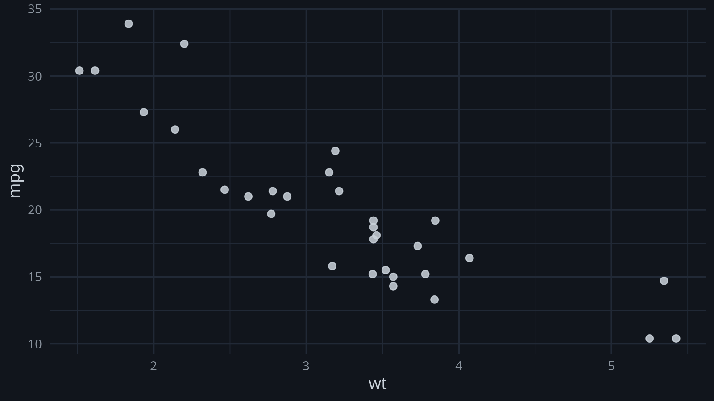




**Versão** 0.1.0 · **Licença** [CC-BY-4.0](https://spdx.org/licenses/CC-BY-4.0) (conteúdo), [MIT](https://spdx.org/licenses/MIT) (código) · [pacote completo](ro-crate-metadata.json)

**Palavras-chave:** mtcars, regressão

::: {.callout-note}
## Carregando o R no seu navegador

Os preditores desta página rodam em R dentro do navegador (WebR). A primeira visita baixa o R e os pacotes e leva cerca de um minuto; as seguintes usam o cache. Nenhum dado digitado sai do seu computador.
:::

::: {.callout-tip collapse="true"}
## Como citar

Josiah Carberry (2026). Consumo e peso dos carros. Versão 0.1.0. trama-teste-publicar.
:::

::: {.callout-tip collapse="true"}
## Como reproduzir

Baixe o pacote, instale o trama e as coleções de `ambiente.json`, traga os dados de `dados-entrada.json` (mesmo sha256) e abra `flow.json` no editor. O `README.md` traz o passo a passo.
:::

## Tabela

| modelo | mpg | cyl | disp | hp | drat | wt | qsec | vs | am | gear | carb |
|:---|---:|---:|---:|---:|---:|---:|---:|---:|---:|---:|---:|
| Mazda RX4 | 21 | 6 | 160 | 110 | 3.9 | 2.62 | 16.46 | 0 | 1 | 4 | 4 |
| Mazda RX4 Wag | 21 | 6 | 160 | 110 | 3.9 | 2.875 | 17.02 | 0 | 1 | 4 | 4 |
| Datsun 710 | 22.8 | 4 | 108 | 93 | 3.85 | 2.32 | 18.61 | 1 | 1 | 4 | 1 |
| Hornet 4 Drive | 21.4 | 6 | 258 | 110 | 3.08 | 3.215 | 19.44 | 1 | 0 | 3 | 1 |
| Hornet Sportabout | 18.7 | 8 | 360 | 175 | 3.15 | 3.44 | 17.02 | 0 | 0 | 3 | 2 |
| Valiant | 18.1 | 6 | 225 | 105 | 2.76 | 3.46 | 20.22 | 1 | 0 | 3 | 1 |
| Duster 360 | 14.3 | 8 | 360 | 245 | 3.21 | 3.57 | 15.84 | 0 | 0 | 3 | 4 |
| Merc 240D | 24.4 | 4 | 146.7 | 62 | 3.69 | 3.19 | 20 | 1 | 0 | 4 | 2 |
| Merc 230 | 22.8 | 4 | 140.8 | 95 | 3.92 | 3.15 | 22.9 | 1 | 0 | 4 | 2 |
| Merc 280 | 19.2 | 6 | 167.6 | 123 | 3.92 | 3.44 | 18.3 | 1 | 0 | 4 | 4 |
| Merc 280C | 17.8 | 6 | 167.6 | 123 | 3.92 | 3.44 | 18.9 | 1 | 0 | 4 | 4 |
| Merc 450SE | 16.4 | 8 | 275.8 | 180 | 3.07 | 4.07 | 17.4 | 0 | 0 | 3 | 3 |
| Merc 450SL | 17.3 | 8 | 275.8 | 180 | 3.07 | 3.73 | 17.6 | 0 | 0 | 3 | 3 |
| Merc 450SLC | 15.2 | 8 | 275.8 | 180 | 3.07 | 3.78 | 18 | 0 | 0 | 3 | 3 |
| Cadillac Fleetwood | 10.4 | 8 | 472 | 205 | 2.93 | 5.25 | 17.98 | 0 | 0 | 3 | 4 |
| Lincoln Continental | 10.4 | 8 | 460 | 215 | 3 | 5.424 | 17.82 | 0 | 0 | 3 | 4 |
| Chrysler Imperial | 14.7 | 8 | 440 | 230 | 3.23 | 5.345 | 17.42 | 0 | 0 | 3 | 4 |
| Fiat 128 | 32.4 | 4 | 78.7 | 66 | 4.08 | 2.2 | 19.47 | 1 | 1 | 4 | 1 |
| Honda Civic | 30.4 | 4 | 75.7 | 52 | 4.93 | 1.615 | 18.52 | 1 | 1 | 4 | 2 |
| Toyota Corolla | 33.9 | 4 | 71.1 | 65 | 4.22 | 1.835 | 19.9 | 1 | 1 | 4 | 1 |

32 linhas e 12 colunas; acima, as 20 primeiras. [Baixar a tabela completa (CSV)](itens/ler/dados.csv)

## Regressão linear

```{ojs}
//| echo: false
viewof v_lm_wt = Inputs.range([1, 6], {value: 3.5, step: 0.1, label: "wt"})
viewof v_lm_hp = Inputs.range([50, 350], {value: 200, step: 5, label: "hp"})
v_lm_motor_url = new URL("itens/lm/motor.rds", document.baseURI).href
```

```{webr}
#| edit: false
#| echo: false
#| input:
#|   - v_lm_wt
#|   - v_lm_hp
#|   - v_lm_motor_url
if (!file.exists("lm-motor.rds")) download.file(v_lm_motor_url, "lm-motor.rds")
motor <- readRDS("lm-motor.rds")
prever <- function(motor, novos) data.frame(previsto = as.numeric(predict(motor, newdata = novos)))
novos <- data.frame(`wt` = v_lm_wt, `hp` = v_lm_hp, check.names = FALSE)
r <- prever(motor, novos)
cat(sprintf("mpg previsto: %s\n", format(r$previsto[[1]], digits = 6)))
```

*Pré-processamento:* Nenhum fora do modelo: a fórmula (mpg ~ wt + hp) é aplicada pelo predict() do stats.

## Figura

{fig-alt="Figura"}

[Baixar a figura](itens/disp/figura.png)

## O fluxo

{fig-alt="Diagrama do fluxo"}

## Versões

O modelo foi ajustado com as versões da coluna *treino*; o navegador carregou as da coluna *navegador*.

```{webr}
#| edit: false
#| echo: false
treino <- c(`R` = "4.6.0")
nav <- vapply(names(treino), function(p) if (p == "R") paste(R.version$major, R.version$minor, sep = ".") else tryCatch(as.character(packageVersion(p)), error = function(e) "ausente"), "")
print(data.frame(pacote = names(treino), treino = unname(treino), navegador = unname(nav)), row.names = FALSE)
```
